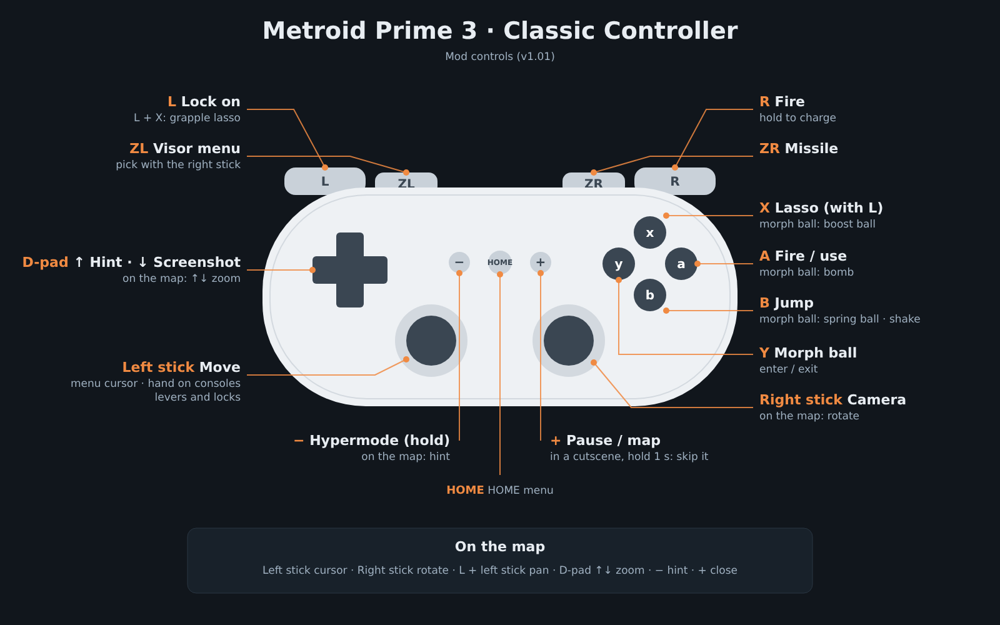

# Metroid Prime 3: Corruption — Classic Controller mod

Gecko codes to play **Metroid Prime 3: Corruption** (Wii, PAL **RM3P01**) with the **Classic Controller** (or Classic Controller Pro), using twin-stick controls in the style of *Metroid Prime Remastered*. No pointing at the screen and no motion gestures.

**Current version: v1.01.** Tested and working on **Dolphin** and on a **real Wii** (USB Loader GX).

## Features
- **Twin-stick aiming:** left stick moves, right stick turns the camera with a centred reticle (based on PrimeHack).
- **Fixed-position screens** (ship cockpit, consoles, code entry, levers): the right stick moves the camera and the left stick moves Samus's hand, which stays where you leave it.
- **No gestures:** grapple lasso with L + X, shake with B, spring ball with B and boost ball with X in morph ball, levers and locks with the left stick.
- **Comfortable menus:** left-stick cursor, magnetic visor menu, two-stick map with zoom on the D-pad.
- **Skip cutscenes:** hold + for one second.
- **Normal Wii HOME menu:** the mod stays out of the way while it is open.

Full list in [docs/CHANGES.md](docs/CHANGES.md).

## Controls
| Classic Controller | Action |
|---|---|
| Left stick | Move · menu cursor · hand on consoles · levers and locks |
| Right stick | Camera · pick a visor |
| R or A | Fire (hold to charge) |
| L | Lock on (L + X: grapple lasso) |
| ZR | Missile |
| ZL | Visor menu |
| B | Jump · shake · spring ball in morph ball |
| Y | Morph ball |
| X (morph ball) | Boost ball (hold, then release) |
| + | Pause / map · in a cutscene, hold 1 s to skip it |
| − (hold) | Hypermode |
| D-pad up / down | Hint · screenshot (on the map: zoom) |
| HOME | HOME menu |

## Installation
You need the **European PAL release (RM3P01)**. Other releases (RM3E01, Japanese, Trilogy) are not supported.

**Dolphin**
1. Enable cheats: *Config → General → Enable Cheats*.
2. Copy [`codes/RM3P01.ini`](codes/RM3P01.ini) to `Documents/Dolphin Emulator/GameSettings/` (back up any existing `RM3P01.ini` first).
3. Set Wii Remote 1 to *Emulated Wii Remote* and choose **Classic Controller** as the extension.
4. In the game's *Properties → Gecko Codes*, make sure **Classic Controller v1.01** and **Skip cutscenes (hold + 1 s)** are both ticked.

**Wii (USB Loader GX)**
1. Copy [`codes/RM3P01.gct`](codes/RM3P01.gct) to `SD:/codes/`.
2. In the game's settings in USB Loader GX, set **Ocarina: On**.
3. Plug the Classic Controller into the Wii Remote before starting the game.
4. If the loader says it cannot find the cheat file, copy [`codes/RM3P01.txt`](codes/RM3P01.txt) to `SD:/txtcodes/` and create the GCT from the loader's cheat manager. If the codes have no effect, try another *Hook Type* (e.g. VBI or AXNextFrame).

More detail in [docs/GUIDE.md](docs/GUIDE.md).

## Files
| Path | Contents |
|---|---|
| `codes/RM3P01.ini` | Both codes, enabled, for Dolphin |
| `codes/RM3P01.gct` | Both codes, for the Wii (USB Loader GX) |
| `codes/RM3P01.txt` | Both codes in the cheat-manager text format |
| `codes/classic_controller.txt`, `codes/skip_cutscenes.txt` | Each code on its own, to paste by hand |
| `docs/` | Guide, full change list, version history and controls image |
| `src/make_code.py` | Generator for the codes (PowerPC assembly → Gecko) |

To rebuild the codes: `pip install keystone-engine capstone`, then `python src/make_code.py`. It writes the output files to the current folder. (Comments in the source are in Spanish.)

## Notes
- Together the two codes take 3192 bytes. Dolphin allows at most 3272 bytes of Gecko codes in total, so don't enable other large codes at the same time.
- The in-game button icons still show the Wii Remote.
- Don't touch the sticks while the game boots: the Wii takes that position as the centre.

## Credits
- Made by **AdrianGR517**, with the help of **Claude** (Anthropic's AI assistant), which wrote and debugged most of the PowerPC code and documentation together with him.
- Motion-control and camera patches are based on [PrimeHack](https://github.com/shiiion/dolphin).

## License
[MIT](LICENSE)
